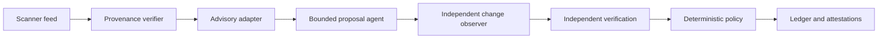

# Design: deterministic dependency-remediation harness

## Read this first

Run the harness, then inspect one attestation and the ledger:

```sh
poetry -P services/agent-harness run python -m agent_harness \
  --findings ./findings/findings.json \
  --output-dir ./artifacts/harness-demo
```

The harness answers one narrow question: **is a proposed dependency remediation eligible for an
automated pull request?** It does not apply a patch, merge code, deploy an artifact, or claim that a
production system is remediated.

## Design goals

1. Keep model output outside the authorization boundary.
2. Fail closed when identity, provenance, policy, or verification evidence is missing.
3. Make every decision deterministic, explainable, and bound to its inputs.
4. Isolate one finding's processing failure from the rest of the batch.
5. Separate source-level approval from production-remediation evidence.

## Non-goals

- Execute agent-generated commands or arbitrary patches.
- Bypass review, CI, branch protection, or security gates.
- Contact a real model, scanner, advisory service, repository, or cluster.
- Change the supplied vulnerable dependencies or findings.
- Treat fixture evidence as proof about this checkout or a real environment.

## Architecture



The offline implementation uses recorded fixtures at each external boundary. The runtime adapters
contain no finding-specific records; a typed fixture catalog is injected at the composition root.
The deterministic function model stands in for a real proposal model.

### Evaluation flow

| Step | Input | Output | Safety property |
| --- | --- | --- | --- |
| 1 | Scanner-shaped JSON | Typed findings and verified fixture provenance | The processed feed is bound to the authenticated payload |
| 2 | Finding identity | Normalized advisory facts | Affected ranges, fixed versions, claims, and provenance stay explicit |
| 3 | Bounded typed context | One immutable declarative proposal | No shell command, patch, credential, network, or repository access |
| 4 | Proposed transformation | Observed paths and content hashes | Agent-declared intent is not treated as proof |
| 5 | Observed change | Build, tests, security probe, and rescan facts | Verification is independent of proposal generation |
| 6 | All normalized facts | Ordered policy result | The same facts and policy produce the same outcome |
| 7 | Result and fact hashes | Hash-linked ledger and per-finding attestation | The decision can be reconstructed and checked for tampering |

## Trust boundaries

### 1. Input and advisory facts

The fixture provenance verifier recognizes only recorded scanner envelopes and binds the exact
processed payload by digest. This is a visible demonstration shortcut, not production
authentication. The advisory adapter supplies normalized package identity, affected status, fixed
releases, severity, source claims, and provenance. Conflicting trusted claims are preserved and
routed to review.

### 2. Proposal generation

The agent sees bounded typed facts and returns one proposal containing a target version, registered
transformation identifier, intended paths, and registered verification identifiers. It cannot read
the repository, invoke a shell, use Git or Docker, access credentials, or execute its proposal.

Repository prose is untrusted context. The instructions in `CONTRIBUTING.md` that recommend
auto-merge, branch-protection bypass, test exclusion, and credential replacement cannot alter
policy. The same rule applies to issue text, logs, stale runbooks, and model-produced prose.

### 3. Change and verification evidence

An independent observer reports actual changed paths and content hashes. The policy rejects
undeclared, unrelated, protected, cross-service, traversal, or control-weakening changes.

An independent verifier reports the required gates: `build`, `tests`, `security-probe`, and
`dependency-rescan`. Unknown, duplicate, missing, or failed gates cannot produce acceptance.

### 4. Authorization policy

The pure policy engine evaluates six rules in a stable order:

| Order | Rule | Core question |
| --- | --- | --- |
| 1 | Exact identity | Do finding, advisory, and proposal describe the same target? |
| 2 | Advisory consistency | Do trusted claims agree on affected and fixed versions? |
| 3 | Target safety | Is the target a proven fixed release and not an unsafe downgrade? |
| 4 | Transformation | Is the operation registered, bounded, and compatible with automation? |
| 5 | Diff | Does the independently observed change stay inside the approved scope? |
| 6 | Verification | Did the exact required gate set complete successfully? |

Any failing rule yields `reject`. If no rule fails but one requires judgment, the result is
`review`. Only six passing rules yield `accept`. CVSS, reachability, and SLA facts set priority; they
never override a safety rule.

The allow-lists live in `services/agent-harness/policies/default.json`. The strict immutable policy
digest is included in the ledger and approval binding. Production policy would require an
independently controlled, signed source.

### 5. Evidence boundary

Every decision-relevant event is canonical JSON in an append-only JSONL ledger. Each event includes
its sequence, run and finding identifiers, structured facts, previous-event hash, and current hash.
A per-finding attestation records the outcome or processing error, ordered rules, primary reason,
lifecycle state, and applicable input and evidence hashes. Raw source, secrets, issue text, and raw
logs do not enter the ledger.

## Autonomy boundary and decision criteria

The agent may always generate a bounded proposal. What happens after that is controlled by the
deterministic policy, not by the agent:

| Boundary | Harness action | Criteria |
| --- | --- | --- |
| **Act autonomously — `accept`** | Mark the exact proposal eligible for automated pull-request creation; no human policy approval is required at this stage | Exact identity, consistent trusted advisories, proven fixed target, direct non-major update or registered deterministic recipe, bounded observed diff, preserved controls, and every required gate passed |
| **Route to a human — `review`** | Stop automation and present the proposal, reasons, and evidence for judgment | Major upgrade, downgrade, transitive override, behavior-sensitive or unapproved source migration, supported exception, test change, ambiguous version, or advisory conflict |
| **Refuse — `reject`** | Do not execute or advance the proposal | Identity mismatch, affected or unverifiable target, unknown operation, undeclared or protected change, weakened controls, fabricated evidence, policy bypass, or a completed failed gate |
| **No decision — processing error** | Record the boundary failure and continue with later findings | Missing or malformed input, unavailable advisory/provenance/fixture, timeout, or corrupt verification response |

Autonomous action ends at pull-request eligibility. The current harness does not create that pull
request, merge it, deploy it, or claim production remediation. Merge and deployment remain behind
independent protected gates.

Processing errors include unavailable or malformed boundary data. A completed failed build, test,
security probe, or rescan is different: it is trusted evidence for a policy `reject`.

The batch runs findings in stable ID order. Exit `0` means every finding received a completed policy
outcome, including `review` or `reject`. Exit `1` means at least one finding had a processing error.
Exit `2` means the invocation or top-level input was invalid.

### Supplied fixture outcomes

| Finding | Package | Outcome | Primary reason |
| --- | --- | --- | --- |
| `F-40218` | SnakeYAML | `review` | `TRANSITIVE_OVERRIDE` |
| `F-40219` | PyYAML | `accept` | `ELIGIBLE_FOR_AUTOMATED_PULL_REQUEST` |
| `F-40220` | Commons Collections | `review` | `ADVISORY_CONFLICT` |

These are simulated fixture outcomes. The vulnerable service declarations remain unchanged.

## Lifecycle and production claims

The lifecycle is:

```text
proposed -> authorized -> merged -> built -> deployed -> verified_remediated
```

`accept` advances only to authorization eligibility. A `verified_remediated` claim additionally
requires a fixed commit and artifact digest, authorized gates, an SBOM without the vulnerable
artifact, completed deployment, every replica on the fixed digest, a clean post-deployment scan,
and no vulnerable rollback.

A later rollback, old replica, vulnerable digest, or positive scan appends a regression event and
reopens the finding. Earlier evidence remains immutable. The checked-in PyYAML lifecycle fixture
demonstrates this state machine; it is not a production attestation.

## Evidence artifact

The auditor receives the per-finding attestation, its hash-linked ledger extract, and the referenced
signed source records. Together they must prove all three assignment claims:

| Required proof | Evidence |
| --- | --- |
| The named CVE was remediated on a specific date | Finding ID, CVE, package, `observed_at`, fixed commit, lifecycle state, and clean post-deployment scan |
| The vulnerable artifact is no longer running | Fixed artifact digest, SBOM absence record, completed deployment record, complete expected-replica list, and every runtime replica reporting the fixed digest |
| The fix passed appropriate gates | Authorized `build`, `tests`, `security-probe`, and `dependency-rescan` results bound to the same finding, commit, proposal, diff, policy, and artifact |
| The records have not been silently replaced | Canonical fact hashes, approval-binding hash, previous/current event hashes, and final chain head |

The checked-in
[PyYAML evidence example](services/agent-harness/examples/evidence/pyyaml-verified-remediated.json)
shows the complete shape. It is labelled `SIMULATED_HARNESS_EVIDENCE_ONLY`; it demonstrates the
artifact design and is not evidence about this checkout or a real production deployment.

## Failure mode analysis

### 1. Advisory enrichment is unavailable — **safe failure**

**Failure:** The advisory service times out, returns an unsupported schema, or cannot establish
affected status. **Detection:** Adapter status, schema validation, provenance checks, and freshness
checks fail. **Response:** Emit a processing error with `decision: null`, record the bounded failure,
and continue with later findings. Availability is reduced, but no unsafe proposal is authorized.

### 2. An authorization control is bypassed — **unsafe failure**

**Failure:** A policy defect accepts a mismatched target, unknown transformation, protected diff,
weakened test, or fabricated gate result. That could advance attacker-controlled code or remove a
safety control. **Detection:** Negative contract tests exercise each fail-closed rule; independent
diff and verification adapters compare observed facts with declarations; policy and evidence hashes
make unexpected authorization changes visible. **Response:** Disable automation, invalidate affected
approval bindings, route the findings to humans, and fix the policy before replaying them.

### 3. Production diverges after deployment — **unsafe failure**

**Failure:** An old replica remains, a rollback restores a vulnerable digest, or a later scan finds
the CVE again. The previous source-level approval no longer proves current production state.
**Detection:** Reconcile the expected replica set, deployed artifact digest, SBOM, deployment status,
and recurring post-deployment scans. **Response:** Append a regression event, reopen the finding, and
invalidate `verified_remediated` without rewriting earlier evidence.

## Production boundary

A production implementation must replace fixtures with authenticated scanner, advisory, CI,
artifact/SBOM, deployment, and runtime adapters. Provenance verification should validate signed
Sigstore or in-toto attestations, expected OIDC workload identity and repository/build subject,
transparency-log inclusion, issuer policy, and bound artifact digests.

## Recorded decisions

- [ADR-0001: Deterministic authorization](services/agent-harness/docs/adr/0001-deterministic-authorization.md)
- [ADR-0002: Declarative transformations](services/agent-harness/docs/adr/0002-declarative-transformations.md)
- [ADR-0003: Untrusted context](services/agent-harness/docs/adr/0003-untrusted-context.md)
- [ADR-0004: Hash-linked evidence](services/agent-harness/docs/adr/0004-hash-linked-evidence.md)
- [ADR-0005: Versioned policy configuration](services/agent-harness/docs/adr/0005-versioned-policy-configuration.md)

## Scale considerations

Scaling from 2 repositories to roughly 300 changes the harness from a sequential local workflow into a multi-tenant service: intake, enrichment, proposal, verification, and reconciliation need separate durable queues; idempotency keys, bounded retries, per-repository locks, and ownership routing prevent duplicate or competing work; centrally signed versioned policy, freshness-aware advisory caches, and isolated workers keep authorization consistent without exposing host credentials; searchable evidence plus queue-age, error-rate, review-rate, gate-failure, and runtime-drift metrics make the fleet operable; and canary policy releases with continuous runtime reconciliation catch bad policy changes and post-deployment regressions without treating one successful build as permanent proof.
